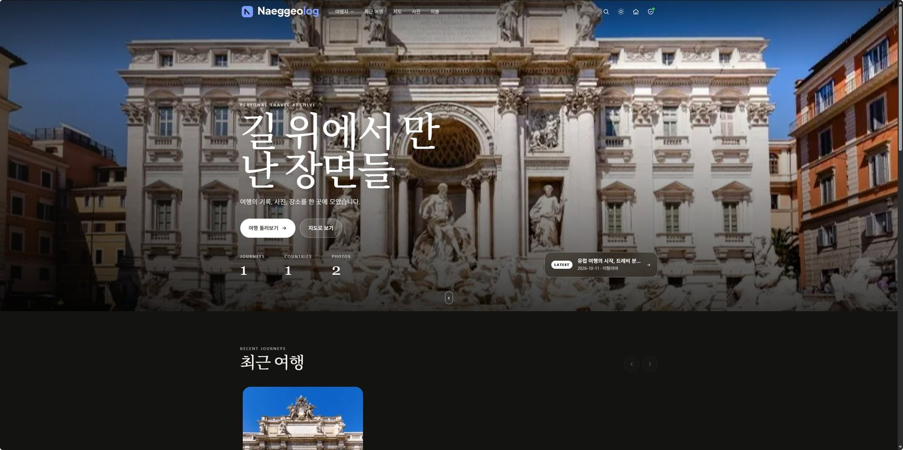
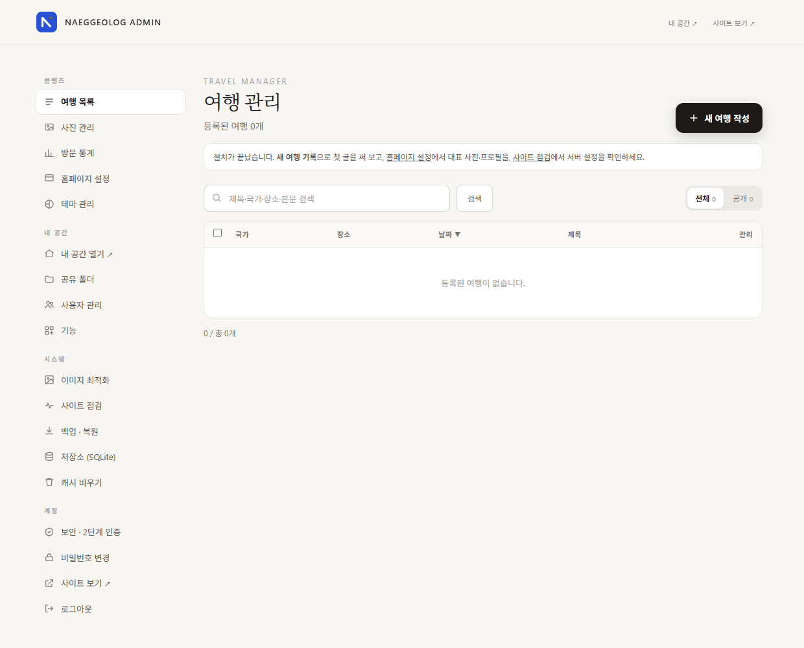
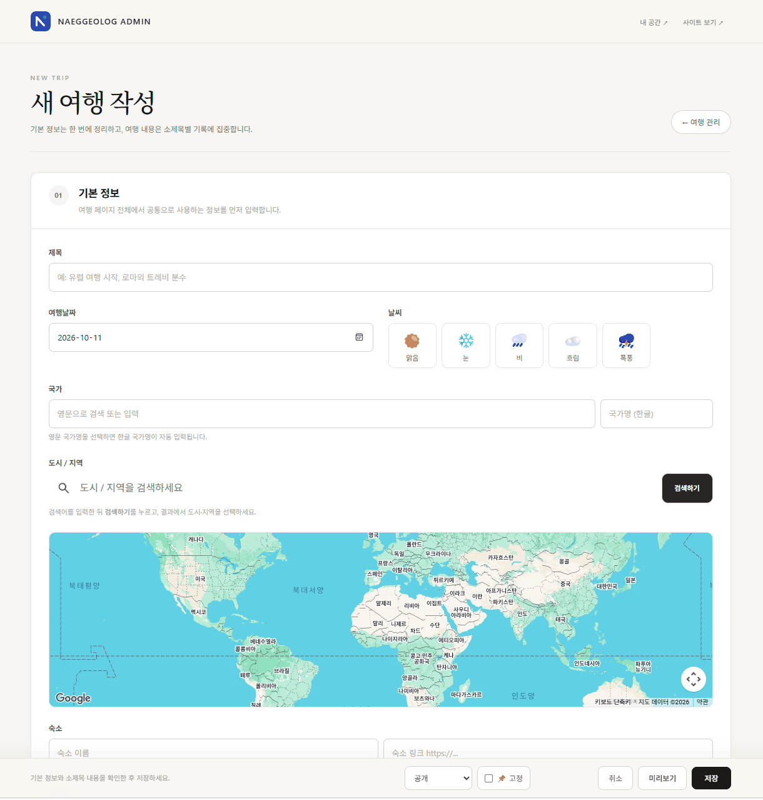
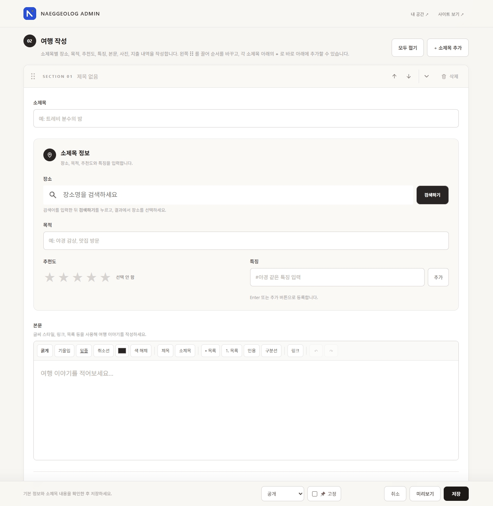
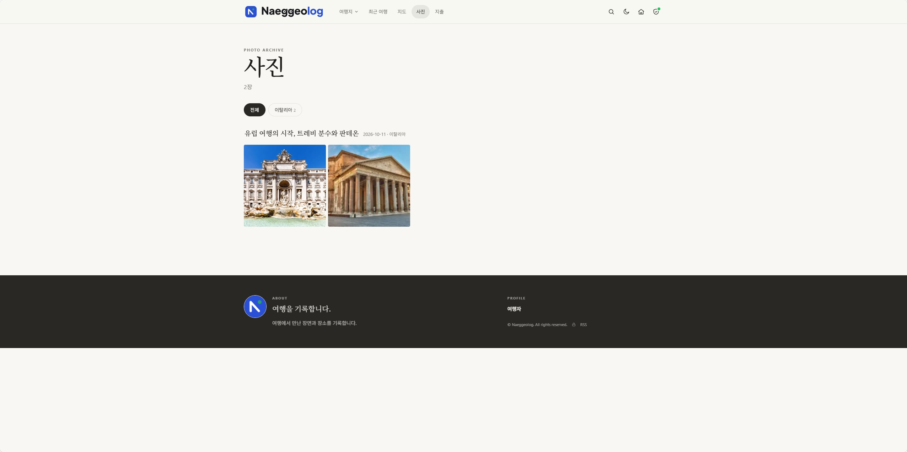
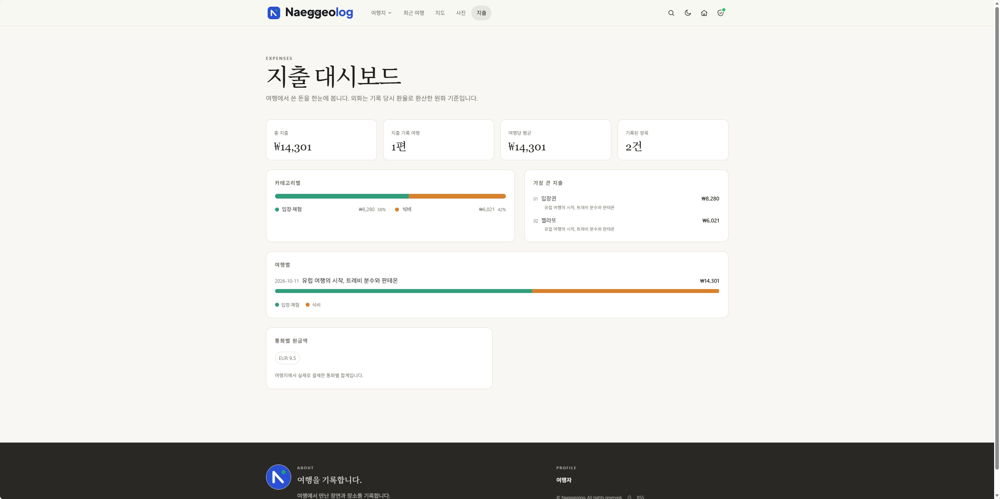
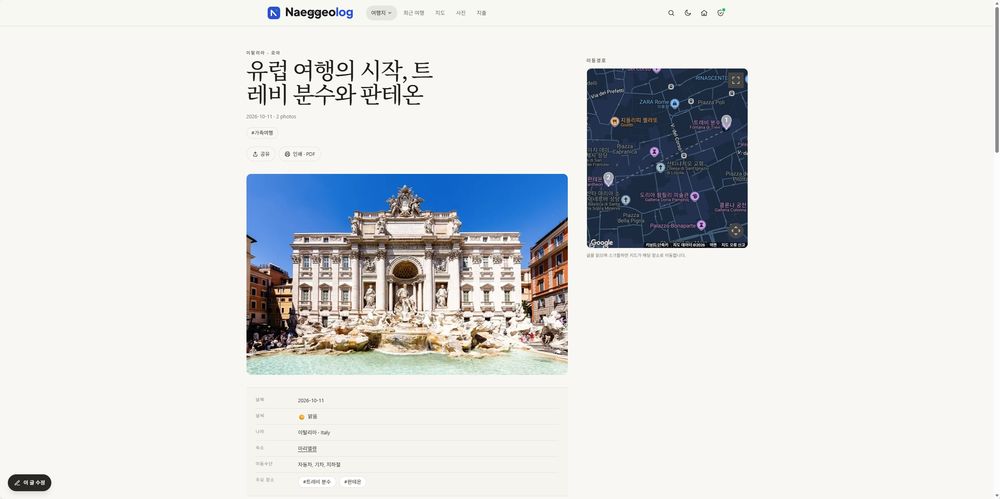
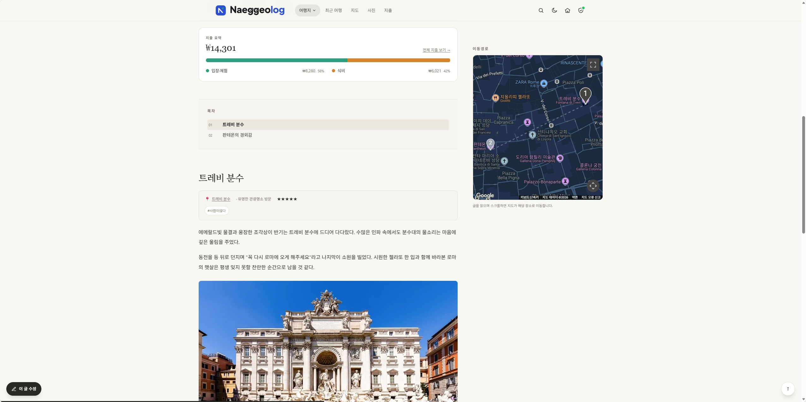
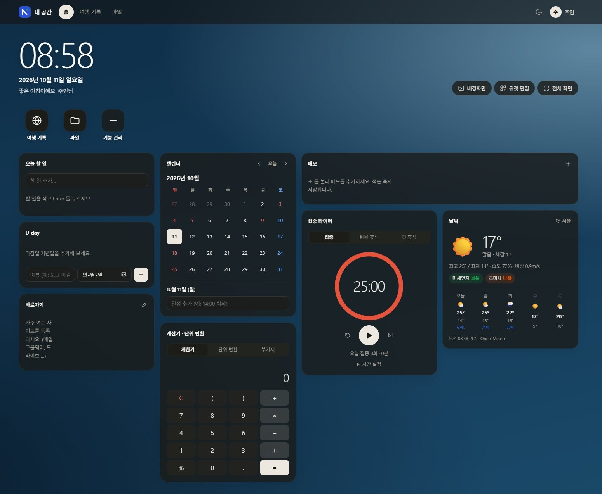
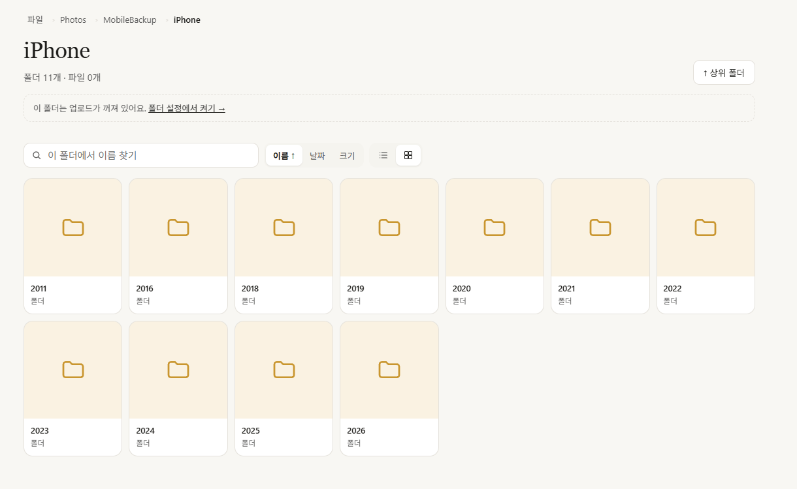

<p align="center">
  <picture>
    <source media="(prefers-color-scheme: dark)" srcset="assets/logo-dark.svg">
    
  </picture>
</p>

# Naeggeolog — 나만의 설치형 여행 블로그, '내꺼로그'

사진과 장소 중심으로 여행을 기록하는 **PHP + SQLite 여행 블로그**입니다.
데이터베이스 서버 없이 웹 호스팅·NAS(Synology 등)·개인 PC(Laragon/XAMPP)에 폴더째 올리면 바로 동작하고,
가족·지인과 NAS 폴더를 나눠 쓰는 **"내 공간"** 기능이 함께 들어 있습니다.

<p align="center">
  
  <br><sub>홈 화면 — 대표 사진 위에 제목과 여행 통계가 놓이고, 아래로 최근 여행·지도·사진이 이어집니다.</sub>
</p>

## 주요 기능

**공개 사이트**
- 여행 글(소제목별 장소·본문·사진·지출), 국가·태그별 모아보기, 본문 전체 검색
- 홈 히어로 · 여행 지도(Google Maps) · 장소 띠 · 사진 갤러리(라이트박스) · 지출 대시보드
- 다크 모드, 테마 색상 변경, PWA(홈 화면 추가·오프라인 페이지), RSS(`feed.php`), 사이트맵(`sitemap.php`)
- 사진은 업로드 시 자동 축소·위치정보(GPS) 제거, WebP 썸네일 자동 생성

**관리자 (`/admin/`)**
- 리치 텍스트 편집기, 자동 저장·임시 저장·버전 기록, 예약 공개·숨김·고정
- **사진으로 자동 정리**: 여러 장을 올리면 촬영 시각·위치(EXIF)로 섹션을 자동 구성
- HEIC(아이폰) 사진은 브라우저에서 JPG 로 변환해 업로드
- 홈페이지 설정(사이트 이름·대표 사진·프로필), 테마 관리, 방문 통계
- 백업 내려받기·복원, 서버 자동 스냅샷, 사이트 점검(환경 진단), 캐시·썸네일 관리
- 로그인 시도 제한, 로그인 기록, **2단계 인증(TOTP)** 과 복구 코드

**내 공간 (`/hub/`)**
- 가족·지인 계정 발급(임시 비밀번호 → 첫 로그인 시 변경)
- 서버(NAS) 폴더를 계정별로 공유 — 보기·내려받기, 주인은 올리기·새 폴더(대용량 분할 업로드)
- 개인 대시보드 — 할 일·D-day·캘린더·메모·집중 타이머·날씨·계산기·바로가기 위젯, 배경화면·위젯 편집
- 모듈 방식으로 기능 추가 가능 (`hub/modules/README.md`)

## 화면 둘러보기

### 관리자 — 여행 관리


`/admin/` 에서 여행 글, 사진, 방문 통계, 홈페이지·테마 설정과 백업·보안까지 한 곳에서 관리합니다.
설치를 마치면 바로 이 화면으로 들어오고, 오른쪽 위 **새 여행 작성**으로 첫 글을 시작합니다.

### 새 여행 작성
<table>
  <tr>
    <td width="50%" valign="top"></td>
    <td width="50%" valign="top"></td>
  </tr>
  <tr>
    <td valign="top"><b>① 기본 정보</b><br>제목·날짜·날씨·국가를 입력하고, 지도에서 도시를 검색해 위치를 정합니다. 숙소·이동수단·태그도 함께 남길 수 있습니다.</td>
    <td valign="top"><b>② 소제목별 기록</b><br>장소·목적·추천도·특징을 정리하고, 편집기로 본문을 쓰고, 사진과 지출을 붙입니다. 소제목은 끌어서 순서를 바꿀 수 있습니다.</td>
  </tr>
</table>

여러 장의 사진을 한 번에 올리면 촬영 시각·위치(EXIF)를 읽어 소제목을 자동으로 나눠 주고(아이폰 HEIC 도 지원), 작성 중인 글은 자동 저장됩니다.

### 사진


<b>사진</b>은 작성된 여행에 첨부되어 있는 사진을 한번에 보여줍니다. 국가별로 필터링해서 확인할 수 있습니다. 사진을 클릭하면 해당 여행으로 이동합니다.

### 지출


<b>지출</b>은 여행 중 발생한 비용을 정리해서 보여줍니다. 카테고리, 여행별, 통화별 등 입력한 지출 정보를 정리해서 나타냅니다.

### 여행 페이지
<table>
  <tr>
    <td width="50%" valign="top"></td>
    <td width="50%" valign="top"></td>
  </tr>
  <tr>
    <td valign="top"><b>① 작성된 기본 정보</b><br>작성된 내용이 테이블 형태로 정리되어 나타냅니다. 내용의 오른쪽은 소제목에 작성한 장소를 이동경로로 구글지도를 통해 보여줍니다.</td>
    <td valign="top"><b>② 소제목별 기록</b><br>작성한 장소의 기본 정보를 나타내고, 텍스트 편집기로 작성한 본문과 사진을 나타냅니다.</td>
  </tr>
</table>

여러 장의 사진을 한 번에 올리면 촬영 시각·위치(EXIF)를 읽어 소제목을 자동으로 나눠 주고(아이폰 HEIC 도 지원), 작성 중인 글은 자동 저장됩니다.

### 내 공간 — 대시보드


`/hub/` 는 가족·지인과 함께 쓰는 개인 공간입니다. 시계와 할 일·D-day·캘린더·메모·집중 타이머·날씨·계산기 위젯을 자유롭게 배치하고 배경화면을 바꿀 수 있습니다.

### 내 공간 — 공유 폴더


관리자가 연결한 서버(NAS) 폴더를 계정별로 나눠 보여 줍니다. 경로를 따라 탐색하고 이름·날짜·크기로 정렬하거나 목록·격자로 볼 수 있으며,
업로드를 허용한 폴더에는 파일을 올리고 새 폴더를 만들 수 있습니다.

## 요구 사항

| 항목 | 내용 |
|---|---|
| PHP | 8.0 이상 |
| 필수 확장 | `pdo_sqlite`, `gd`, `fileinfo`, `mbstring` |
| 권장 확장 | `zip`(백업), `exif`(사진 회전·촬영 정보) |
| 웹 서버 | Apache 2.4 권장(`.htaccess` 로 비밀 폴더 보호). Nginx 는 아래 보안 항목 참고 |
| 선택 | Google Maps API 키 — 지도·장소 검색에만 필요. 없어도 나머지 기능은 모두 동작 |

## 설치

1. 이 저장소를 내려받아 웹 서버의 문서 폴더(또는 하위 폴더)에 올립니다.
   ```bash
   git clone https://github.com/IanLEE89/naeggeolog.git travel
   ```
2. 웹 서버 계정(예: `www-data`, `apache`, Synology 는 `http`)에 아래 폴더의 **쓰기 권한**을 줍니다.
   `private/` · `cache/` · `travel-photos/`
3. 브라우저에서 `https://사이트주소/admin/` 에 접속하면 **설치 화면**이 열립니다.
   서버 환경 점검 결과를 확인하고 **사이트 이름 · 관리자 아이디 · 비밀번호**(와 선택적으로 Google Maps API 키)를 입력하면 끝입니다.
4. 관리자 화면에서 **새 여행 기록**으로 첫 글을 작성하세요.

> 설치 화면은 관리자 계정이 만들어지기 전까지 **누구나** 열 수 있습니다. 서버에 올린 뒤 바로 설치를 마치세요.
> 관리자 계정을 처음부터 다시 만들고 싶다면 `private/admin.json` 을 지우면 설치 화면이 다시 열립니다.

### 환경별 메모
- **Windows (Laragon/XAMPP)**: `C:\laragon\www\travel` 처럼 폴더째 복사 → `http://localhost/travel/admin/`.
- **Synology NAS**: Web Station 에서 PHP 프로필에 위 확장을 켜고, HTTP 서버는 *Apache 2.4* 를 고르세요.
  File Station → 폴더 속성 → 권한에서 `http` 사용자에 읽기/쓰기를 줍니다.
- **공유 폴더(내 공간)**: 공유할 폴더에 웹 서버 계정의 읽기(올리기를 허용하려면 쓰기) 권한이 필요합니다.
  PHP `open_basedir` 를 쓰는 서버라면 그 경로를 추가하세요.

## 설정

### Google Maps
설치 화면에서 입력하거나, 나중에 **관리자 → 홈페이지 설정 → Google Maps** 에서 넣고 바꿀 수 있습니다.
(직접 파일로 만들 경우 `private/google-maps.php`)
```php
<?php
return ['api_key' => '여기에 API 키', 'map_id' => '지도 ID(선택)'];
```
Google Cloud Console 에서 **Maps JavaScript API** 와 **Places API (New)** 를 켜고,
키는 반드시 **HTTP 리퍼러(내 사이트 주소)** 와 **API 종류**로 제한하세요.

### 서버별 설정 (`config.local.php`)
`config.local.php.sample` 을 `config.local.php` 로 복사해 필요한 줄만 켭니다.
사이트 주소(`SITE_URL`), 시간대(`SITE_TZ`), 비밀 폴더 위치(`PRIVATE_DIR`), 사진 최대 크기(`PHOTO_MAX_EDGE`),
내 공간 폴더 선택 시작 위치(`HUB_BROWSE_ROOTS`) 등을 바꿀 수 있습니다. 이 파일은 git 에 올라가지 않습니다.

### 로고 · 아이콘
- 상단 로고: `assets/logo.svg`(밝은 배경용)와 `assets/logo-dark.svg`(어두운 배경용 — 다크 모드·첫 화면 사진 위)가 쓰입니다.
  내 로고로 바꾸려면 같은 이름의 SVG(또는 `logo.png` · `logo-dark.png`)로 교체하세요. 어두운 버전이 없으면 밝은 로고의 색을 반전해 쓰고,
  로고 파일을 모두 지우면 **사이트 이름이 글자로** 표시됩니다.
- 파비콘·앱 아이콘: `favicon.ico`, `assets/favicon.svg`, `assets/logo_icon.png`(512px, 관리자·내 공간·기본 프로필), `assets/icon-192.png`, `assets/icon-512.png`,
  `assets/icon-maskable-512.png`(여백 포함 정사각형 — 안드로이드 홈 화면용), `assets/apple-touch-icon.png`(180px, 투명 없이)를 같은 크기의 이미지로 바꾸면 됩니다.

## 보안
- `private/` 에는 관리자 계정·DB·API 키가, `travel-photos/` 에는 사진이 저장됩니다. **둘 다 git 에 올리지 마세요**(`.gitignore` 에 이미 들어 있음).
- Apache 에서는 동봉된 `.htaccess` 가 `private/`, `cache/` 의 직접 접근과 `.git` 노출을 막습니다. 사이트 설정에서 `AllowOverride` 가 켜져 있어야 합니다.
- **Nginx** 처럼 `.htaccess` 를 읽지 않는 서버는 `config.local.php` 에서 `PRIVATE_DIR` 을 **웹 루트 밖**으로 지정하고, 아래처럼 막아 두세요.
  ```nginx
  location ~ /(private|cache/html|_dev|\.git)/ { deny all; }
  location ~ \.(json|sqlite|zip|md|sample)$ { deny all; }
  ```
- 설치 후 **관리자 → 사이트 점검**에서 노출 여부·권한·HTTPS 를 확인하고, **보안 · 2단계 인증**을 켜는 것을 권장합니다.

## 업데이트
새 버전의 파일로 덮어쓰기만 하면 됩니다. `private/`, `travel-photos/`, `config.local.php` 는 저장소에 없으므로 그대로 유지됩니다.
DB 구조 변경은 첫 접속 시 자동으로 적용됩니다. 덮어쓰기 전에 **관리자 → 백업 · 복원**에서 백업을 받아 두세요(사진 폴더는 별도로 복사).

## 폴더 구조
```
admin/          관리자 화면
hub/            내 공간(회원·공유 폴더·대시보드), hub/modules/ 에 기능 모듈
includes/       공용 PHP (저장소·이미지 처리·렌더링·보안)
assets/         CSS·JS·아이콘 (assets/app.css 는 _dev 에서 빌드된 결과)
_dev/           CSS·편집기 번들 소스 (웹 접근 차단)
docs/           README 용 화면 캡처
private/        ← 실행 중 생성: 관리자 계정, SQLite DB, 설정, 백업
cache/          ← 실행 중 생성: 썸네일, 본문 캐시
travel-photos/  ← 실행 중 생성: 업로드한 사진
```

## 개발 (CSS·JS 다시 빌드)
배포본에는 빌드된 파일이 들어 있으므로 일반 사용자는 이 단계가 필요 없습니다.
```bash
cd _dev
npm install
npm run build:all   # assets/app.css, assets/gallery.js, admin/vendor/naeggeolog-editor.js 등을 다시 생성
```

## 포함된 외부 라이브러리
- TipTap / ProseMirror (MIT) — `admin/vendor/naeggeolog-editor.js` 로 번들
- PhotoSwipe (MIT) — `assets/gallery.js` 로 번들
- @googlemaps/markerclusterer (Apache-2.0) — `assets/vendor/markerclusterer.js`
- heic-to (LGPL-3.0, libheif 포함, 수정 없이 별도 파일로 포함) · exifr (MIT) — `admin/vendor/LICENSES-photo.txt`, `admin/vendor/LICENSE-LGPL-3.0.txt` 참고
- qrcode-generator (MIT) — `admin/vendor/qrcode.js` (2단계 인증 QR)

자세한 고지는 [`NOTICE`](NOTICE) 파일에 있습니다.

## 라이선스
[Apache License 2.0](LICENSE) © 2026 IanLEE89

자유롭게 사용·수정·재배포할 수 있습니다(상업적 이용 포함). 재배포할 때는 `LICENSE` 와 `NOTICE` 를 함께 포함하고, 수정한 파일에는 변경 사실을 표시해 주세요.
Naeggeolog 이름과 로고는 이 프로젝트를 나타내는 표시이므로, 수정본을 다른 이름으로 배포할 때는 로고를 교체해 주세요.
